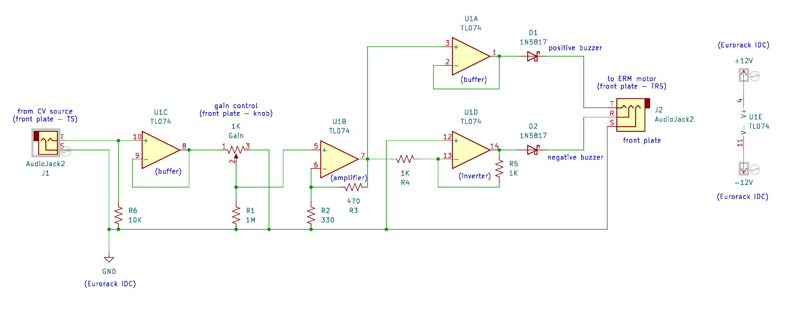

# hapticDriver

#### hapticdriv}

Part of [synthaccess](../README.md)

[ABILITY Project](http://ability.nyu.edu) / [Integrated Design & Media](http://idm.engineering.nyu.edu)   
New York University

Files:
- README.md - this file
- LICENSE.md - MIT license
- [hapticdriver.pdf](./hapticdriver.pdf) - PDF schematic for the driver design
- hapticDriver - folder of KiCad source files

The **hapticDriver** is a circuit schematic to translate a standard modular synthesizer voltage into something that can activate a pair low-cost [ERM motors](https://www.precisionmicrodrives.com/eccentric-rotating-mass-vibration-motors-erms), allowing a Blind / Low Vision user to "feel" a synthesizer signal such as an envelope, low frequency oscillator, trigger, and so forth. The circuit is DC coupled and uses standard Eurorack (+12V/-12V) power rails. It divides the positive and negative sides of the input signal into a pair of motors wired as the tip and ring on a 3.5mm TRS jack, and has an attenuator knob to control signal strength.

