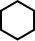
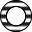
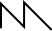
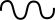

# tactileSynthGuides

#### tactilesyn?guides

Part of [synthaccess](../README.md)

[ABILITY Project](http://ability.nyu.edu) / [Integrated Design & Media](http://idm.engineering.nyu.edu)   
New York University

Files:
- README.md - this file
- LICENSE.md - MIT license
- [Style Guide](./guides/TactileSynthsStyleGuide.pdf) - PDF style guide
- [ARP 2600](./guides/ARP2600.pdf) - tactile guide for the ARP 2600 / The Human Comparator TTSH
- [Roland SH-101](./guides/RolandSH_101.pdf) - tactile guide for the Roland SH-101 / Superlative SB01
- [Roland 100 Model 101](./guides/Roland100_101.pdf) - tactile guide for the Roland 100 Series Model 101
- [Roland 100 Model 102](./guides/Roland100_102.pdf) - tactile guide for the Roland 100 Series Model 102
- [Roland 100_Model 104](./guides/Roland100_104.pdf) - tactile guide for the Roland 100 Series Model 104
- [Roland V-Stage](./guides/RolandV-Stage.pdf) - tactile guide for the Roland V-Stage
- [Serge 73-75](./guides/Serge7375.pdf) - tactile guide for the Serge Modular 73-75 Panels
- elements - folder of EPS, SVG, and PNG tactile elements for standard synthesizer affordances
- elements/serge - folder of EPS, SVG, and PNG tactile elements for Serge synthesizers (matched with [tactileModular](../tactileModular))

**tactileSynthGuides** consist of a collection of tactile guides and standards for synthesizers. These are currently designed to be printed using swell-form or UV printing as little booklets, with the goal of allowing a B/LV user to "feel" the synthesizer interface as a spatial map on a page while working with the physical hardware. 

We provide a standard vocabulary of tactile symbols in the Style Guide and the elements folder - for example, different crosshatch patterns to give different feels for inputs and outputs on modular systems. These are especially useful for legacy (non-MIDI-aware) synthesizers that have a densely packed physical interface; conceptually, tactile guides are one of the only ways to do accessibility with things like Eurorack-format modular equipment where the affordance space is too small to accommodate braille. In addition, we offer suggested tactile shapes for visual labels that commonly appear on synthesizers (ADSR curves, sine waves, etc.); these can be integrated into a guide in addition to braille for fast recognition.

### Style Guide Tactile Symbols (Legacy and Eurorack)

| Affordance  | Tactile Symbol |
| ------------- | ------------- |
| Input Jack |  |
| Output Jack |  |
| Bidirectional Jack |  |
| Knob |  |
| Horizontal Slider |  |
| Vertical Slider |  |
| Round Button |  |
| Square Button |  |
| 2-way Switch |  |
| 3-way Switch  |   |
| Power Control |  |

| Visual Label  | Tactile Symbol |
| ------------- | ------------- |
| ADSR symbol |  |
| Falling Saw |  |
| Pulse |  |
| Rising Saw |  |
| Sawtooth |  |
| Sine |  |
| Square |  |
| Triangle |  |

### Style Guide Tactile Symbols (Serge Modular)

| Affordance  | Tactile Symbol |
| ------------- | ------------- |
| AC Input Jack (Black / Brown) |  |
| AC Output Jack (Black / Brown) |  |
| DC Input Jack (Blue / White) |  |
| DC Output Jack (Blue / White) |  |
| Pulse Input Jack (Red) |  |
| Pulse Output Jac (Red) |  |
| Misc Input Jack (Various) |  |
| Misc Output Jack (Various) |  |
| TRS Input Jack |  |
| TRS Output Jack |  |
| Basic Knob |  |
| Offset Knob |  |
| Scale Knob (Attenuverter) |  |
| Button |  |

